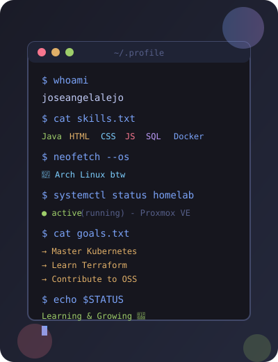
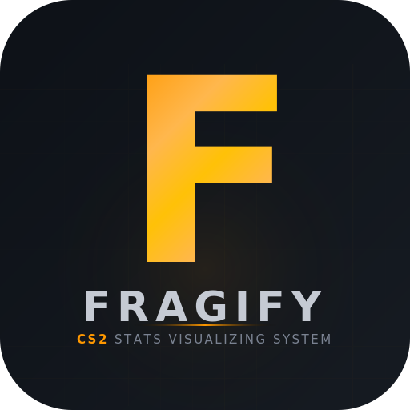
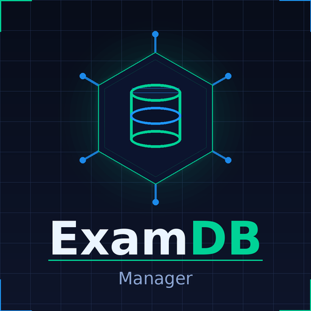
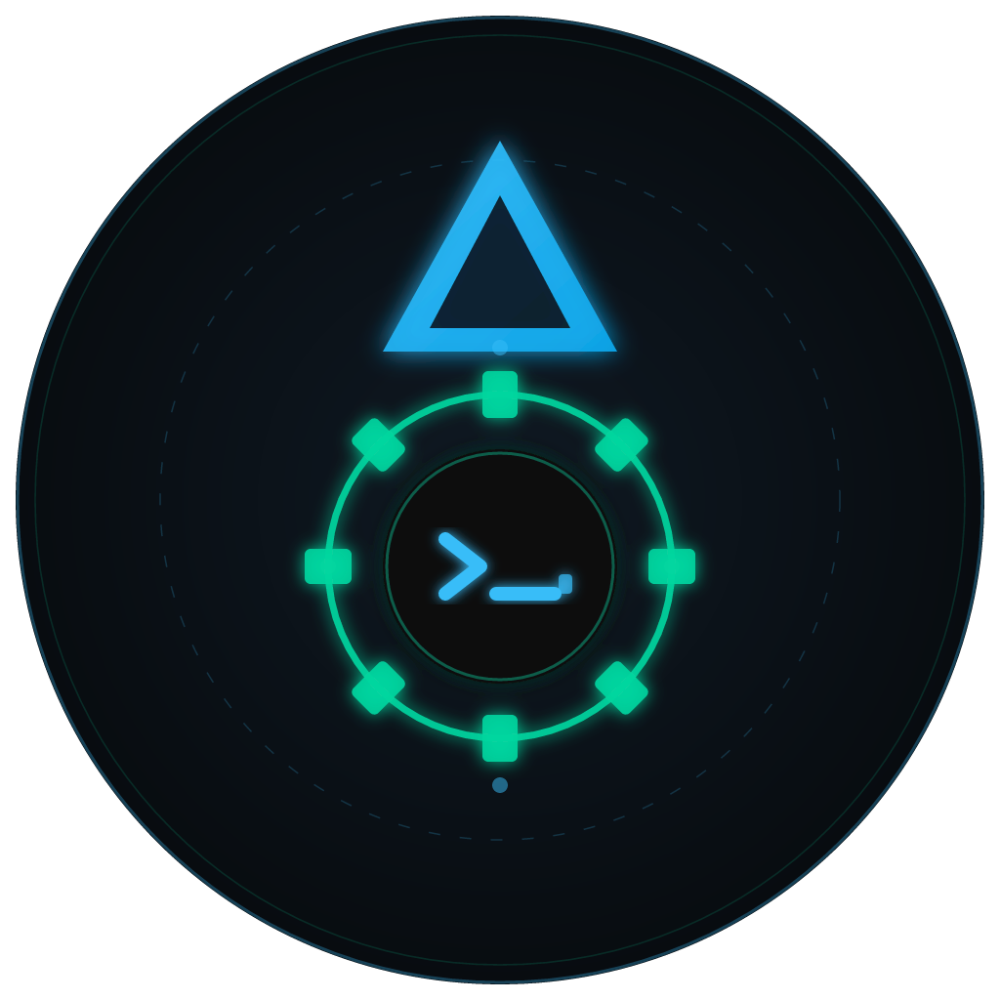
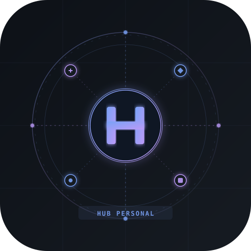

### Hey!

[](https://git.io/typing-svg)

├── &nbsp;&nbsp; I'm **José Ángel**, a **Full-Stack developer in training** from Seville, in my second year of **DAW** and aiming at **DevOps / DevSecOps**.

├── &nbsp;&nbsp; I build web apps with **TypeScript, Next.js and React** on PostgreSQL / MySQL, and ship them with **Docker, nginx and GitHub Actions**.

├── &nbsp;&nbsp; I run a self-hosted **homelab** on **Proxmox VE**: Docker, Headscale, n8n, Immich and local AI with Ollama, exposed through Cloudflare Tunnel.

└── &nbsp;&nbsp; Next: **Kubernetes, Terraform and Ansible**, an internship in DevSecOps / cybersecurity, and more open source.

[](https://portfolio.joseangelinfra.dev) [](https://www.linkedin.com/in/joseangelalejosillero/) [](mailto:joseangelcorptiv@gmail.com)

<br clear="left"/>

---

#### **Tech Stack**

| Level                 | Technologies                                                                                                                                                                                                                                                                                                                                                                                                                                                                                                                                                                                                                                                                                                                                                                                                                                                                                                                                                                                                                                                                                                                                                                                                                                                                                                                                                                                                                                                                                                                                                                                                                                                                                                                                                                                  |
| --------------------- | --------------------------------------------------------------------------------------------------------------------------------------------------------------------------------------------------------------------------------------------------------------------------------------------------------------------------------------------------------------------------------------------------------------------------------------------------------------------------------------------------------------------------------------------------------------------------------------------------------------------------------------------------------------------------------------------------------------------------------------------------------------------------------------------------------------------------------------------------------------------------------------------------------------------------------------------------------------------------------------------------------------------------------------------------------------------------------------------------------------------------------------------------------------------------------------------------------------------------------------------------------------------------------------------------------------------------------------------------------------------------------------------------------------------------------------------------------------------------------------------------------------------------------------------------------------------------------------------------------------------------------------------------------------------------------------------------------------------------------------------------------------------------------------------- |
| **Use daily**         |              |
| **Working knowledge** |                                                                                                                                                                                                                                                                                                                                                                                                                                                                                                                                                                                                                                                                                                                                    |
| **Learning**          |                                                                                                                                                                                                                                                                                                                                                                                                                                                                                                                                                       |

---

#### **Homelab**

```text
Cloudflare Tunnel ─┐
Nginx ─────────────┤
Headscale ─────────┼──▶  Proxmox VE  ──▶  Docker · n8n · Immich · Ollama (Tars)
```

A Proxmox VE host with the services I actually use and maintain: public apps behind **Cloudflare Tunnel** and **nginx**, private access over **Headscale**, automation with **n8n**, photos with **Immich** and a local assistant with **Ollama**. I also host Minecraft servers there (Vanilla and Forge, with Docker), and several of my projects below run there.

---

#### **Currently Learning**

- **DAW** — second year at IES Hermanos Machado (2026–2027)
- **Kubernetes** — continuing from the Linux Foundation course (LFS158)
- **Cybersecurity** — self-study roadmap toward SOC / SOAR
- **Done:** DevOps (LFS162) and GitOps (LFS169)

---

#### **Featured Projects**

<table>
<tr>
<td width="100" align="center">

</td>
<td>

**[Fragify](https://fragify.joseangelinfra.dev)** — *CS2 stats platform*

Stats for Counter-Strike 2 built from **2,904 real matches** imported from Steam: K/D, HS% and win rate computed in SQL, Premier and Competitive leaderboards, Steam OpenID login, Telegram bot and an admin panel.

**[Live](https://fragify.joseangelinfra.dev)** · **[GitHub](https://github.com/joseangelalejo/Fragify_CS2SVSS)**

   

</td>
</tr>
<tr>
<td width="100" align="center">

</td>
<td>

**Yukiko** — *Multiplatform bot & web dashboard*

One monorepo, three platforms (Discord, Telegram, mobile over WebSocket) with a browser chat, local AI through **Ollama**, economy and moderation. Admin panel on Vercel, **Neon PostgreSQL + Drizzle ORM**, running 24/7 on my homelab with PM2.

**[Web](https://yukiko.vercel.app)** · **[Docs](https://joseangelalejo.github.io/yukiko)** · **[GitHub](https://github.com/joseangelalejo/yukiko)**

    

</td>
</tr>
<tr>
<td width="100" align="center">

</td>
<td>

**ExamDB Manager** — *Exam environment generator*

Teachers create databases for an exam, generate student users and credentials from a CSV, and hand them out. JWT auth, DDL/DML tooling, TiDB Cloud, **Docker + nginx**, with **Playwright** E2E tests and CI on GitHub Actions.

**[Live](https://examdb-manager.joseangelinfra.dev)** · **[GitHub](https://github.com/joseangelalejo/examdb-manager)**

    

</td>
</tr>
<tr>
<td width="100" align="center">

</td>
<td>

**Data Explorer & Web IDE** — *Data management platform*

Explore **JSON/CSV** files and connect to **SQLite, PostgreSQL, MySQL and MongoDB**. SQL editor with **Monaco**, interactive tables, dynamic charts, automatic ER diagrams and CSV export. JWT authentication, rate limiting, CSP headers and input sanitisation, deployed with **Docker + nginx**.

**[Live demo](https://data-visualizer-web-ide.vercel.app)** · **[GitHub](https://github.com/joseangelalejo/data-visualizer-web-ide)** · **[Docs](https://github.com/joseangelalejo/data-visualizer-web-ide/wiki)**

    

</td>
</tr>
<tr>
<td width="100" align="center">

</td>
<td>

**MiniPortal** — *Private software distribution platform*

Platform for distributing software and controlling licences, focused on security and access management. Python desktop launcher with DRM protection, TOTP licence checks and active-session tracking, plus a honeypot: a **Flask** analyser that redirects suspicious traffic, role-based access control and Telegram alerts.


   

</td>
</tr>
<tr>
<td width="100" align="center">

</td>
<td>

**[For Honor Hispano](https://forhonorhispano.com)** — *Community website*

Website of the For Honor Hispano community, built with **Next.js**. I develop it and run it day to day.

**[Live](https://forhonorhispano.com)**

 

</td>
</tr>
<tr>
<td width="100" align="center">

</td>
<td>

**[AutomatArch](https://automatarch.joseangelinfra.dev)** — *Discord bot for Arch Linux automation*

Run and manage Arch Linux scripts from Discord, with role-based permissions, audit logging, password auth and Telegram notifications. Python bot plus a **Next.js** setup wizard on Vercel.

**[Live setup](https://automatarch.joseangelinfra.dev)** · **[GitHub](https://github.com/joseangelalejo/AutomatArch)**

  

</td>
</tr>
<tr>
<td width="100" align="center">

</td>
<td>

**[Portfolio](https://portfolio.joseangelinfra.dev)** — *This is my web, rebuilt from scratch*

Bilingual (ES/EN), light and dark, responsive from phone to desktop, with an animated diagram of my homelab. Source of truth in typed data files, deployed on Vercel.

**[Live](https://portfolio.joseangelinfra.dev)** · **[GitHub](https://github.com/joseangelalejo/portfolio.joseangelinfra.dev)**

    

</td>
</tr>
</table>

More on **[portfolio.joseangelinfra.dev](https://portfolio.joseangelinfra.dev)** and in my [repositories](https://github.com/joseangelalejo?tab=repositories).

---

#### **Contact Me**

<div align="center">

[](https://portfolio.joseangelinfra.dev) [](https://www.linkedin.com/in/joseangelalejosillero/) [](mailto:joseangelcorptiv@gmail.com)

</div>

---

#### **GitHub Stats**

<div align="center">


</div>
